

  <a href="https://bythang.com"></a>

  
  
  
  

### About

I'm an **Agentic AI Engineer**. I design workflows where AI agents plan, build, review and ship real software, and I build the full-stack products those agents work on.

- **Agentic workflows** — multi-agent teams in Claude Code and Codex with separate roles (BA, architect, frontend, backend, QA, independent reviewer), custom skills, subagents and MCP servers
- **Agent tooling** — a Tauri/Rust desktop studio that runs and watches Claude Code and Codex sessions, and an eval harness for an AI-guided film builder
- **Engineering base** — Java, Spring Boot, PostgreSQL/PostGIS, Elasticsearch, Kafka, RabbitMQ, Redis on the backend; React, Next.js, TypeScript and Three.js on the frontend

### Engineering projects

  <a href="https://chargeops.online">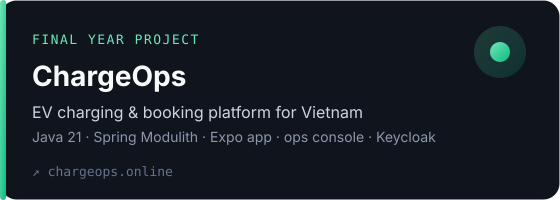</a>

  <a href="https://github.com/phamthang44/internal-room-booking-system">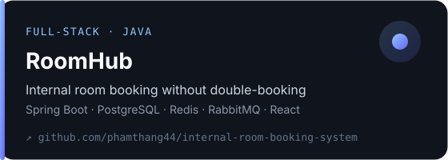</a>
  <a href="https://github.com/phamthang44/Ecommerce-Coursework">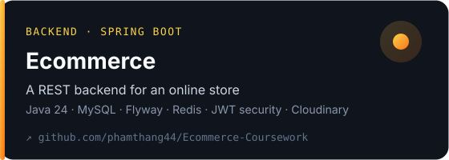</a>

### Products I've shipped

  <a href="https://guicau.bythang.com">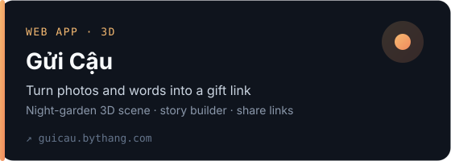</a>
  <a href="https://onemoretime.bythang.com">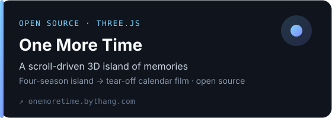</a>
  <a href="https://pickverge.com">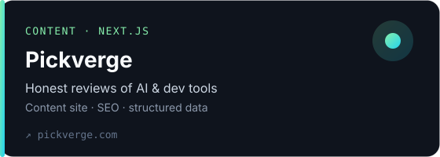</a>
  <a href="https://www.thedelayedsignal.fun">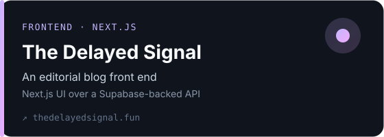</a>
  <a href="https://tamsilk.bythang.com">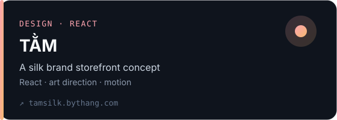</a>
  <a href="https://hienspa.bythang.com">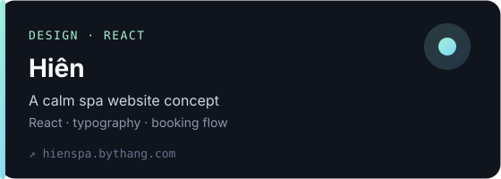</a>

### Stack

  

### Stats

Open the stat sheet (auto-updated daily)

<!-- AWAKEN:START -->
<!-- Generated by git-profile-awaken. Edit awaken.json instead of this block. -->







<a href="https://github.com/phamthang44/internal-room-booking-system"></a>
<a href="https://github.com/phamthang44/internal-room-booking-system-frontend"></a>





<!-- AWAKEN:END -->

